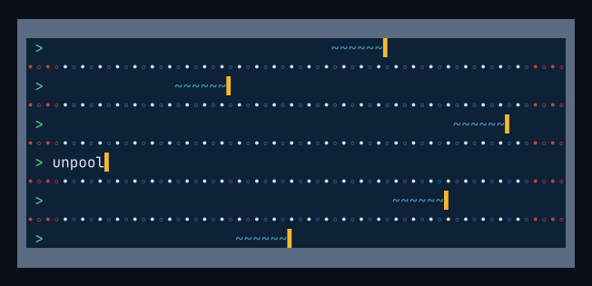

<p align="center">
  
</p>

<p align="center">
  <b>Individual-animal tumour-growth data, recovered from the supplementary
  spreadsheets of open-access papers whose figures show only <code>mean ± SEM</code>.</b>
</p>

<p align="center">
  Guillermo Canudo-Barreras · Independent researcher ·
  <a href="https://orcid.org/0000-0002-1949-9185">ORCID 0000-0002-1949-9185</a><br>
  <a href="#quickstart">Quickstart</a> ·
  <a href="docs/METHODS.md">Methods</a> ·
  <a href="docs/VALIDATION.md">Pre-registered studies</a> ·
  <a href="#citing">Cite</a> ·
  Apache-2.0
</p>

For tumour-growth modellers who need per-animal curves, preclinical
meta-researchers who want to re-analyse rather than re-read, and anyone
building historical control arms so that fewer animals are needed (3Rs).

## Summary

Many papers report tumour growth as group means, yet deposit every animal's
measurements in a Source Data spreadsheet that nobody downloads. `unpool`
finds those sheets, has an agent read each one against its figure legend,
cuts it into one block per arm and, if you choose, hands it to a person to
confirm. Every
figure below was measured in a study registered before it ran
([Methods](docs/METHODS.md)).

| what the shipped version does | result | independent check |
|---|---|---|
| keeps only sheets that really hold per-animal series | **74 of 75 (98.7%)** | -- (this is the independent one, S3) |
| extracts subject count, day grid and arms all correctly | **44 of 50 (88%)** | 41 of 50 (82%) on sheets it was not tuned on (S4) |
| finds the legend of a supplementary figure in the SI PDF | **43 of 57 (75%)**, right **10 of 10** | 26 of 57, 7 of 10 before the last fix (S5) |
| where the kept count matches the legend's arms x n, the row is right | **10 of 10** | -- (S5) |
| writes the campaign as one per-animal CSV (DOI, arm, readout, day, value) | fully right on **41 of 47 sheets (87%)**; **90%** of its animals | on 10 hand-built hard sheets: right wherever read (472/472), but 46% of animals read -- the legend count catches the rest (S8) |
| ships confirmed data that needs no agent (`data/verified_extractions.csv`) | **1,311 animals**, 39 sheets, 13 papers; model, host, role, readout and time axis confirmed against the paper on **37 of 39** | counts, days and arms checked blind; the metadata not blind (S9) |
| first-pass scanner, before the agent reads anything | precision 8 of 20 (40%), recall 15/15 | recall is a tuning-set figure (S2) |
| the same agentic work with a smaller model | Sonnet 5.5: screening 100% / 96%, extraction 43 of 44; Haiku 5.5: screening 100% / 99%, extraction 39 of 44 | same 115 + 44 items as Opus (S6) |

Intervals, populations and caveats are in [Methods](docs/METHODS.md) and
`docs/FIGURES.md`. One rater, the author, throughout; Claude Opus 5.5 as the
agent unless stated -- Sonnet 5.5 does the same job about as well, Haiku 5.5
the screening. A sheet is *data* only once a person has confirmed it --
until then it is a `candidate` (scanner) or `screened` (agent), and the tool
says so.

**One campaign, end to end** (S3, S9). One search, `"patient-derived
xenograft"` in *Nature Communications*: 50 papers, 41 not seen before. The
scanner accepted 173 sheets in 26 papers; the agent kept 75; the rater
confirmed 74 of them, blind, in 21 papers. The sheets whose counts, days and
arms were then confirmed became the starter dataset: 1,311 animals from 13
papers, in one CSV.

## Quickstart

**From Claude Code:**

```
/plugin marketplace add gcanudo-barreras/unpool
/plugin install unpool@unpool
```

then ask *"Use unpool to rebuild the starter dataset"*. The skill asks where
to keep a clone, installs it and runs the export below. Or ask your own
question: *"Find per-animal MC38 tumour growth in Nature Communications."*
Python 3.11+ must be installed.

**From a terminal:**

```bash
git clone https://github.com/gcanudo-barreras/unpool && cd unpool
python3.13 -m venv .venv && . .venv/bin/activate   # Windows: py -3.13 -m venv .venv, then .venv\Scripts\activate (Git Bash: . .venv/Scripts/activate)
pip install -e ".[pdf]"                # spreadsheet parsers + SI-PDF legends
python tests/test_smoke.py             # offline, seconds -> "smoke OK"
```

**Two ways in.** Finding *new* data is agentic: the tool finds candidate
sheets, and something has to read each one against its legend -- an agent
(below) or you. Without that reading you get a list of sheets of which about
4 in 10 are per-animal series. **Data already read and confirmed** needs no
agent:

```bash
unpool export data/verified_extractions.csv -o ../animals.csv
```

downloads 13 open-access supplements (*Nature Communications*, 2026; about
70 MB, 5-20 minutes depending on the publisher's servers, with a progress
line per sheet) and writes **1,311 animals from 39 sheets in 13 papers**:
one row per animal and time point, with DOI, licence, sheet, arm, tumour
model, host, control/treated, readout (tumour volume for 852 animals,
bioluminescence for 459) and the time axis's unit and origin.

**What is checked and what is not.** `state = verified` means a person
checked each sheet's subject count, time points and arm grouping.
**`model`, `host`, `role`, `readout`, `time_axis` and `zero_at_start` were
written by an agent from the legend and methods, then checked by the author**
against the paper -- not blind, the agent's values were in view.
`described_by` names, per row, any field left unconfirmed (2 sheets);
`zero_at_start` was checked against the values themselves (S9). `?` and `not
stated` mean the documents did not settle it. Before fitting: keep one unit
(some volumes are cm3 or unstated), and read `zero_at_start` -- a 0 at the first time point is
copied as written and is often a placeholder for "not yet palpable", which a
log-scale growth model will not forgive. The same control curve can appear in
two panels of one paper. The CSV loads with any CSV reader (`pip install
pandas` if you want pandas; it is not a dependency).

**Your own search**, with an agent doing the reading:

```bash
unpool mine "MC38" --journal "Nature Communications" --budget 50   # 50 papers
unpool worklist runs/mc38_candidates.csv    # one row per paper
unpool paper <PMCID> --sheet "<sheet>"      # legend, methods, group sizes
unpool extract <PMCID> --sheet "<sheet>" --legend
unpool export runs/mc38_extractions.csv -o ../mc38_animals.csv   # the campaign, per animal
```

Python 3.11+. The tool writes `runs/` and `si_cache/` inside the clone, so
install it from one, editable. If `python -c "from unpool import scan;
scan.preflight_banner()"` prints anything, the spreadsheet parsers are
missing and every sheet would be silently rejected.

## Use it from an agent

The skill (`skills/unpool/SKILL.md`) runs the whole workflow and holds the
agent to the output contract: it cannot hand you a candidate as if it were
data.

| harness | install |
|---|---|
| **Claude Code** | `/plugin marketplace add gcanudo-barreras/unpool` then `/plugin install unpool@unpool` |
| **Codex CLI** | copy `skills/unpool/` into `~/.codex/skills/` |
| **OpenCode** | copy `skills/unpool/` into `~/.config/opencode/skills/` |
| anything else | point it at `skills/unpool/SKILL.md`; `AGENTS.md` covers agents working inside this repo |

The skill still needs the clone above: your runs and verdicts live there.

**A new campaign** starts with a plain request: *"Find per-animal tumour
growth for MC38 in Nature Communications, 50 papers."* Name a journal: where
Source Data is required the yield is several times higher (see Where the data
is). The agent confirms the search and asks for one of two modes:

| | what happens | rows in the CSV |
|---|---|---|
| **Direct** | the agent searches, downloads the supplements, reads every candidate sheet against its legend and methods, cuts the real ones by arm and writes the CSV | `screened` (read by an agent) |
| **Checked** | the same, then the desk (`unpool desk`) shows you each kept sheet beside its legend; you answer before you see the agent's verdict | `verified` where you confirmed; your answers can be contributed |

In both modes, the agent ends by listing every sheet where the animals it kept
do not match the legend's arms x n. On a messy or chaotic sheet it can miss a
whole group, so fewer animals come out than the legend describes; it leaves
animals out far more often than it invents them (S8). And sometimes the data a
paper deposits does not match its own legend -- authors, please check your
Source Data against your figures before you publish.

**What a campaign costs**, roughly (V26, not a benchmark): 50 papers queried
gave 267 accepted sheets in 28 papers; mining took 13 minutes, screening and
extracting all 267 took 13 minutes of wall clock with six agents in parallel.
A Sonnet 5.5 agent used about 180k tokens for 25 extractions (V30). Then a
person checks the kept sheets in the desk -- the part that does not
parallelise.

## How it works

1. **Mine** -- search Europe PMC, download each open-access supplement, keep
   the sheets whose *structure* looks like per-subject series.
2. **Screen** -- an agent reads each sheet with its legend and methods and
   keeps the real per-animal series.
3. **Extract** -- `unpool extract` cuts the sheet into one block per arm,
   including GraphPad exports (days down, animals across, the arm named once
   in a merged cell); `--legend` prints the group sizes the legend states, so
   the count can be checked against it.
4. **Verify** (Checked mode) -- `unpool desk` puts each result in front of a
   person, who answers before seeing the agent's verdict. Confirmed sheets go to
   `registry.csv`; for a source you will build on, a builder script
   (`templates/builder.py`) is the permanent record, and `unpool guard` /
   `unpool fingerprint` check it.
5. **Export** -- `unpool export` turns the campaign into one CSV: every
   animal, with its DOI, licence, sheet, arm and values, `DROP`ped blocks left
   out and listed. An animal is `screened` until a person has verified its
   sheet and `verified` after; export can run at either point and says which.

**Look in `registry.csv` before mining:** 111 entries in 56 papers (93
confirmed by a person, 18 re-derived by a builder), each with DOI, journal,
licence, file and sheet. `example/BUILD_REPORT.md` follows one paper the whole
way, with the real output of every step.

## Where the data is

Whether a journal requires a Source Data file per figure decides almost
everything. Of 100 papers per journal that report tumour volume and carry a
supplement, the share with a sheet the scanner accepts (V19, shipped
settings): *Communications Biology* 78%, *Nature Communications* 72%,
*Nature Cancer* 51%, *Nature Medicine* 10%. Same publisher, nearly eight-fold
apart: prestige predicts nothing. These are candidates, not verified data
(S2, S7).
Mice do not report their own data; spreadsheets, sometimes, do.

## Scope and limits

- Tables, not figures: no curve digitisation. Data is read only from
  spreadsheets and flat text; PDFs are read for legends only (693 tables from
  206 PDF/Word supplements held no per-subject series).
- Open access only; attribution travels with the data. No human patient data.
- Longitudinal per-subject readouts (tumour volume, body weight). Not
  dose-response: a concentration axis is not a time axis.
- One rater, the author, measured everything; a second, independent rater is
  the study this project most needs (`CONTRIBUTING.md`, section 0). To contribute
  or collaborate: guillermo@canudo.org or an issue.
- The extraction is right on most sheets, not all: check its blocks before
  using a row. On stacked multi-panel sheets it can leave animals out; the
  legend's arms x n is the check.

## Documentation

| | |
|---|---|
| `docs/METHODS.md` | how every figure above was measured (Supporting Information) |
| `docs/PROTOCOL.md` | the rules a change to the tool must follow |
| `docs/FIGURES.md` | every number, beside its configuration and population |
| `docs/VALIDATION.md` | the full record: each study as registered, then its result |
| `docs/MEASUREMENTS.md`, `docs/NEW_PROFILE.md` | profiles, and pointing the tool at another data type |
| `example/BUILD_REPORT.md` | one paper, end to end |
| `skills/unpool/SKILL.md` | the operational manual, for an agent |

## Citing

If `unpool` or its measurements help your work, cite it: GitHub's "Cite this
repository" button reads `CITATION.cff`.

## Licence

Apache-2.0.
